

# Soul Forge

A free, open source D&D 5e (2024 rules) character builder for Windows, macOS and Linux. It builds on the Aurora element format, keeps its content up to date from links, and imports 5e.tools and Plutonium data.
Original code, not affiliated with Aurora Builder or Wizards of the Coast.

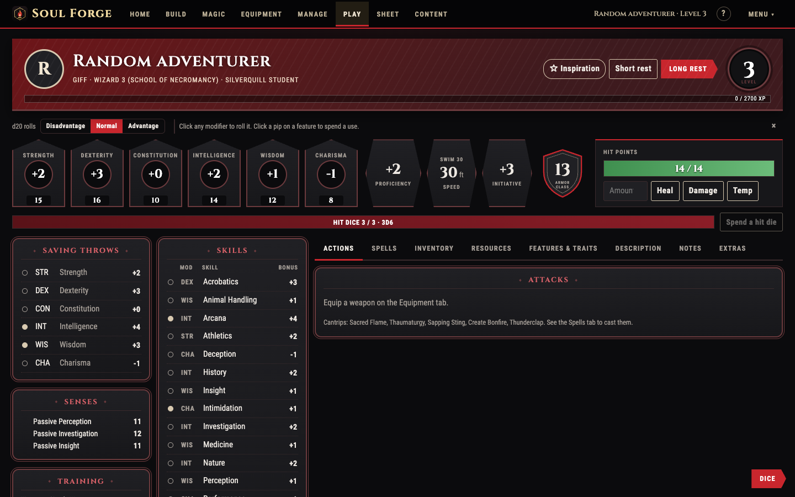

## Features

**Build**
- Species, class and subclass, background, ability scores, languages, proficiencies, feats and multiclassing, using the Aurora element rules (grants, selections, stat bonuses, requirements, spellcasting).
- Filters like 5e.tools on every list, sort by name, recommended or newest, and Badges or List view.
- The same option from several books is one card; pick the book from chips that show the release date, with the newest marked.
- "Choose 3" counters, and a hover list of what is still unchosen on each tab.
- Your own modifiers on any ability score or stat.

**Magic and equipment**
- Spell lists with level, school, class, component, concentration and ritual filters; slots, prepared and always-prepared spells.
- Starting equipment from class, background and gear packs in one click; equip, attune, coins, armor class that follows what you wear.
- Companions, mounts and familiars.

**Play**
- A Play tab laid out like a table sheet: abilities, saves, skills, vitals, rests, hit dice, attacks, spells, inventory, features with clear uses per rest.
- Click any modifier to roll. A dice panel with shaped dice, big results, an optional roll log, and an Advantage / Disadvantage switch.

**Content**
- Content links update by themselves. Add the AuroraLegacy link or any `.index`.
- 5etools and Plutonium data: paste 5e.tools links or search a data folder and import only what you pick.
- Import characters from Foundry VTT and Roll20; write your own homebrew in element XML.

**Sheets and PDFs**
- Fills the official 2024 character sheet, the DLDM 5E24 sheets and the DLDM companion sheets from your own copies.
- Spell, item and feature cards, and tips and tricks for play, can be added to any export.
- Translate the printed text into 18 languages with LibreTranslate or Google Cloud Translation (your own key; nothing is bundled).
- Links to the free official sheets next to the Add sheet button.

**Look**
- Five themes: Obsidian, Leather, Tools blue, Daylight and Printed book. Stock portraits, or your own.
- Quiet help: a **?** button and hints you can dismiss.

## Screenshots

| | |
|---|---|
| 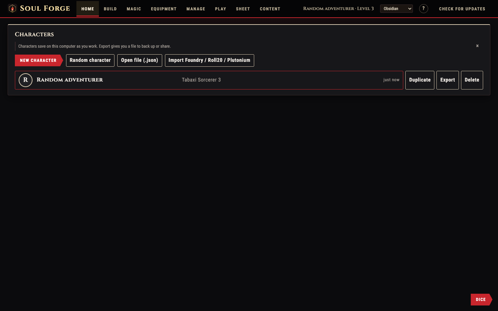 Home | 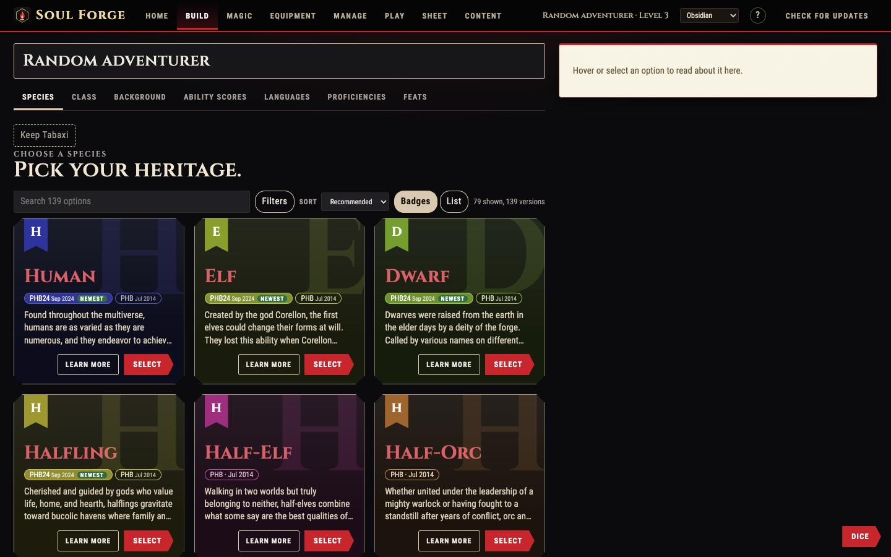 Build |
| 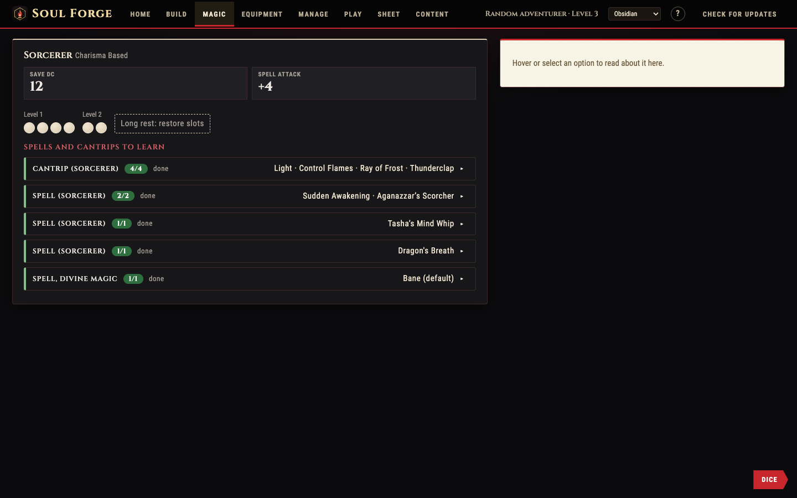 Magic | 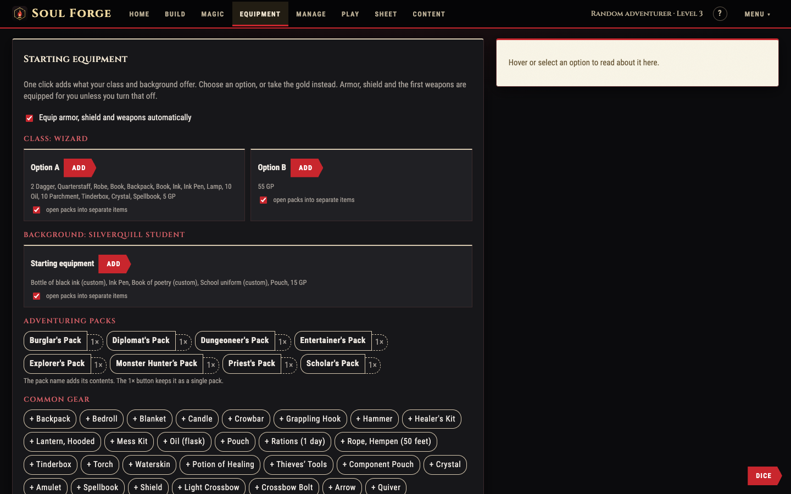 Equipment |
| 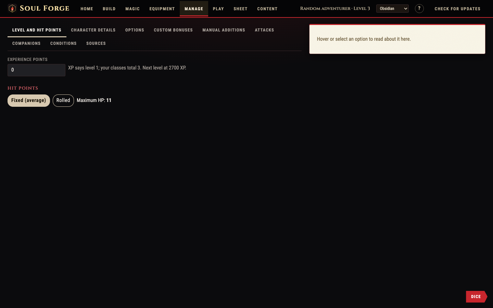 Manage | 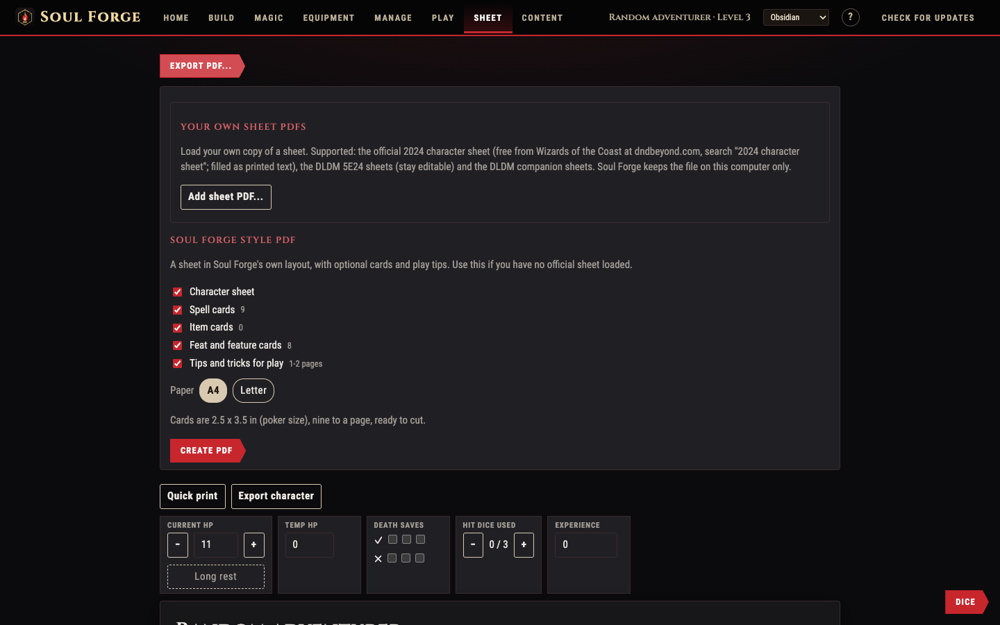 Export |
| 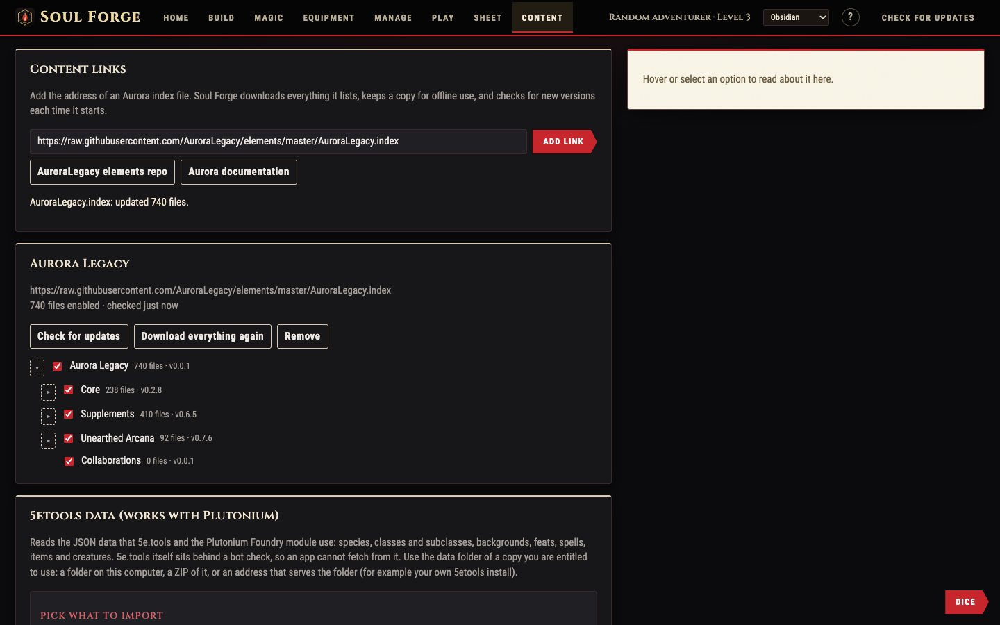 Content | 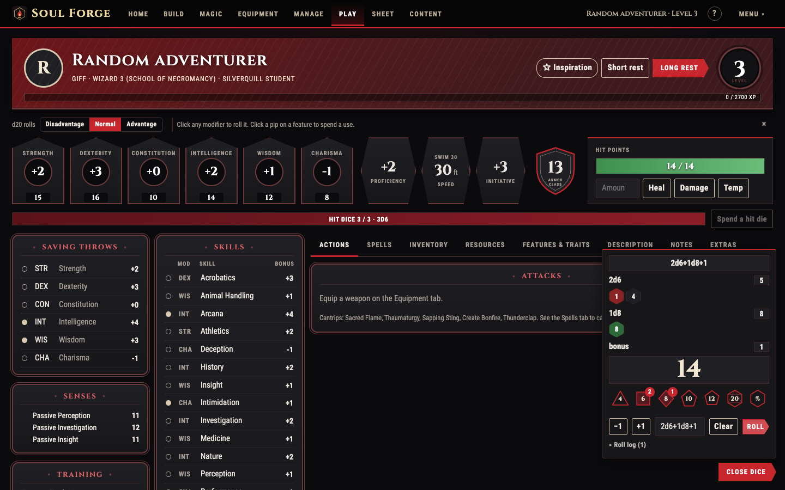 Dice |
| 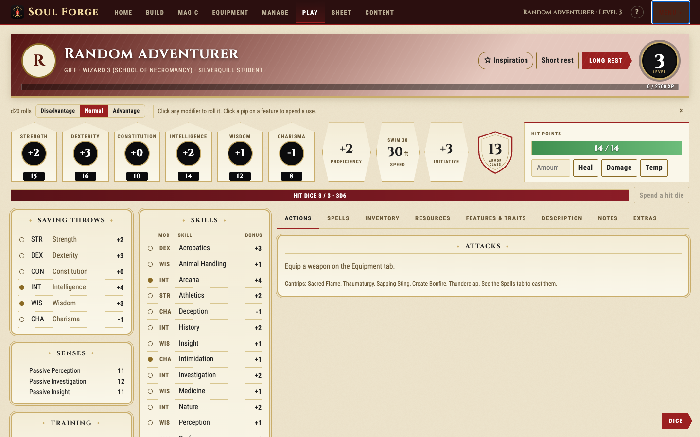 Printed book | 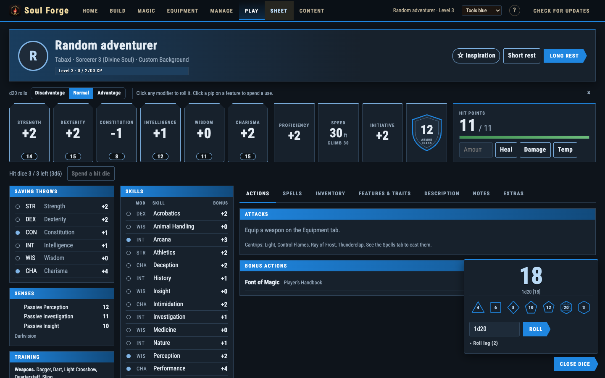 Tools blue |
| 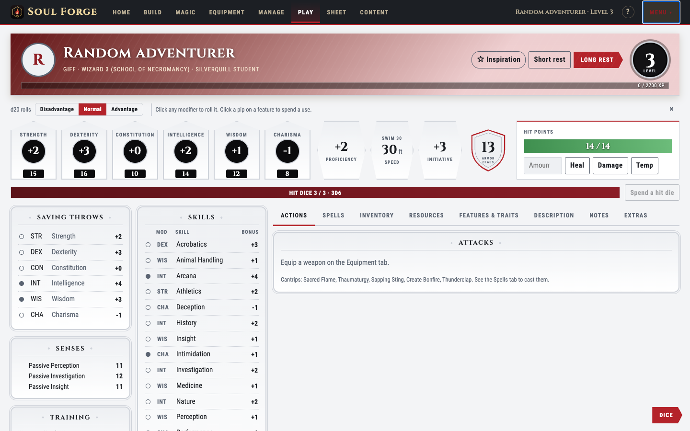 Daylight | |

## Install

| Platform | How |
| --- | --- |
| macOS | `brew install --cask hrozno2/soulforge/soulforge` |
| Arch, CachyOS, Manjaro | Add the pacman repo once (below), then `sudo pacman -S soulforge-bin` |
| Windows | Download the `.exe` or `.msi` from the [latest release](https://github.com/hrozno2/SoulForge/releases/latest) |
| Other Linux | The AppImage (updates itself), or the `.deb` / `.rpm` from the latest release |

### Arch, CachyOS, Manjaro (pacman repository, no AUR)

Each release publishes a small pacman repository. Add it once to `/etc/pacman.conf`:

    [soulforge]
    SigLevel = Optional TrustAll
    Server = https://github.com/hrozno2/SoulForge/releases/download/arch

Then:

    sudo pacman -Syu soulforge-bin

After that, `sudo pacman -Syu` updates Soul Forge together with the rest of the system. Packages are not GPG signed,
so the repo is trusted only over HTTPS from your GitHub account. x86_64 only. To build it yourself instead, copy
`packaging/arch/PKGBUILD` and run `makepkg -si`.

Builds are not code signed yet, so Windows SmartScreen and macOS Gatekeeper may warn on first launch.
The Homebrew cask clears the macOS quarantine flag for you.

## Updates

The app checks for a new version shortly after launch (and from the "Check for updates" button).

| Install type | What happens |
| --- | --- |
| Windows installer, macOS app, Linux AppImage | "Install and restart" downloads the signed update and relaunches |
| Arch, CachyOS (pacman repo) | The app tells you a new version exists. Update with `sudo pacman -Syu` |
| `.deb` / `.rpm` | The app tells you a new version exists and opens the releases page |
| Homebrew cask | The app updates itself. The cask is marked `auto_updates` so `brew upgrade` leaves it alone |

Updates are verified against a public key built into the app, so only releases signed with your key install.

## Publishing (maintainer)

One-time setup, on your own machine with `git`, `node`, `npm` and the GitHub CLI (`gh auth login`):

    scripts/publish.sh            # creates the repo and the Homebrew tap, makes the signing key, sets secrets, pushes

Then cut releases:

    scripts/release.sh 0.2.0      # bumps versions, tags, pushes. CI builds every platform and publishes

CI builds Windows, macOS (Apple silicon and Intel) and Linux (x86_64 and arm64), publishes the release with the
update manifest (`latest.json`), then refreshes the Homebrew cask and the pacman repository (the rolling `arch` release).

### Secrets

| Secret | Set by | Purpose |
| --- | --- | --- |
| `TAURI_SIGNING_PRIVATE_KEY` and `..._PASSWORD` | `scripts/publish.sh` | Signs update files |
| `HOMEBREW_TAP_TOKEN` | you | Fine-grained token with Contents read and write on `homebrew-soulforge`. Without it the cask is not refreshed |

Back up `~/.charforge-signing`. If the key is lost, installed copies can never update again and people must reinstall.

### Before the first release

- Test updating: release `0.2.0`, install it, release `0.2.1`, and launch the old copy.
- CachyOS itself only ships packages its maintainers add. Users get Soul Forge from the pacman repository above.

## Develop

    npm install
    npm run dev            # browser at http://localhost:1420
    npm run tauri dev      # desktop app (needs Rust and the Tauri prerequisites)
    npm run tauri build    # installers for the OS you build on
    npm test

Tauri prerequisites: https://v2.tauri.app/start/prerequisites/

## Documentation

- [User guide](docs/guide.md): every tab, filters, rolling, PDF export, 5etools and Plutonium import, themes.
- [Aurora parity](docs/aurora-parity.md): what the engine supports from the Aurora element format.
- [Usability test](docs/usability-test.md): rebuilding published pregens in the app.

## What it does

A character builder for D&D 5e (2024 rules, and older editions through content files), built around the same element format as Aurora Builder, so existing Aurora content works.

- **Build**: species and subspecies, class with multiclassing and level up, background, ability scores (point buy, standard array, manual), languages, proficiencies, feats and ability score improvements. Every choice comes from rules in the content files, so what you can pick follows the books you load.
- **Magic**: spellcasting per class with save DC, attack, slots (shared multiclass table and Warlock pact slots), cantrips and spells to learn, prepared spells, always-prepared spells, slot tracking.
- **Equipment**: buttons for what players usually add: the starting equipment of the class and background (each option, or the gold instead), adventuring packs (opened into their items or kept whole) and common gear. Plus search for any item, equip, attune, containers, quantities, weight and carrying capacity, coins, custom items. Armor class and attacks follow from what you wear and wield.
- **Manage**: level, XP and hit points (average or rolled), character details and backstory, options, manual additions (extra languages, feats and spells your table allows), custom attacks, companions with stat blocks, conditions, source restrictions.
- **Play**: a play screen laid out like D&D Beyond: ability row, hit points with damage, heal and temporary points, short and long rests, saving throws, senses, skills, and tabs for actions, spells (cast from slots), inventory, features and traits, description, notes and extras. Click any bonus to roll it.
- **Sheet**: a printable sheet with live hit points, death saves, hit dice and spell slots, PDF export of the sheet and printable spell, item and feature cards (A4 or Letter), and filling of fillable character sheet PDFs (see below).
- **Content**: add Aurora content by link and it keeps itself up to date, import the 5etools data that Plutonium uses, import files, or write your own content.

## Content

Soul Forge ships without rules content. Add it on the Content tab.

### Aurora content by link

Paste the address of an Aurora index file, for example the AuroraLegacy elements:

    https://raw.githubusercontent.com/AuroraLegacy/elements/master/AuroraLegacy.index

Soul Forge reads the index and every index it lists, downloads the files, and keeps a copy for offline use. On each launch (at most once an hour) it fetches the small index files again and downloads only the parts whose version changed. You can switch whole books on or off in the tree, force a full re-download, or remove a link.

### 5etools data and Plutonium

The Content tab also reads the JSON data format used by 5e.tools and by the Plutonium module for Foundry VTT: species and subraces, classes with subclasses and features, backgrounds, feats, spells, items and magic items, languages and creatures. Structured parts (proficiencies, saves, speeds, ability bonuses, hit dice, spell slot and prepared tables, weapon and armor statistics, magic bonuses) become rules. Prose stays as description text.

5e.tools itself is behind a bot check, so an app cannot fetch from it. Use the `data` folder of a copy you are entitled to use: pick the folder or a ZIP of it, or give an address that serves it. Homebrew JSON exported from 5etools or Plutonium imports the same way.

Characters made with Plutonium in Foundry export as normal dnd5e actors, so Foundry import on the Start tab reads them.

### Other ways in

- Import a ZIP or loose `.xml` element files.
- Write your own elements in the editor on the Content tab. The format is documented at https://aurorabuilder.com/documentation/

### Not included

No book content ships with Soul Forge and none is bundled by the importers. Content comes from files and addresses you supply. Aurora, the Aurora Legacy team, 5e.tools and Wizards of the Coast are not affiliated with Soul Forge.

## Choosing things

Every list of choices (species, class, background, feats, subclasses, spells, languages and so on) works the same way:

- **Filters**, as on 5e.tools: rule set, source, official or playtest, release year, plus filters that suit the list. Spells filter by level (C for cantrip, 1 to 9), school, class, components (V, S, M), concentration, ritual, casting time and range. Species filter by size, speed and ability increase, classes by hit die and spellcasting, feats by category and prerequisite.
- **Badges or list**, and **sort** by A to Z, Recommended (the usual favourites first, then the newest official books, playtest last) or Newest. The choice is remembered per kind of list.
- **One entry per name.** The versions of the same thing from different books sit together as small tags with the book and release date, newest first, with a "newest" tag and a "playtest" tag for Unearthed Arcana. Pick the version you want on the entry itself. If two content providers supply the same book, it is shown once.
- **Learn more** opens the full description in a window, in any layout.
- Choices that need several picks say so, for example `1/3 choose 2 more (3 total)`, right next to the name. The number on a Build sub tab shows what is left when you hover over it.
- Release dates come from the content (Aurora source files carry them; 5etools books have a publish date).
- Ability scores have a Custom column for your own modifier, and the Manage tab has Custom bonuses for any other statistic.

## Fillable character sheets

The official 2024 sheet from Wizards of the Coast is the default export. It has no form fields, so Soul Forge prints onto it; load your own copy once in the Sheet tab (it is not bundled).

Sheet tab, Export PDF, "Fillable sheets": load your own copy of a sheet PDF once, and Soul Forge fills it in from the character and keeps the fields editable. The PDFs stay on your computer (Soul Forge does not include any sheet).

Supported:

- **DLDM 5E24 character sheets**, the five-page file ("Updated Form Fields" version) or its single pages: Page 1 style A and style B, Page 2 style A (spellcasting, equipment, coins) and style B (equipment, backstory, companion block), and the spell list page. Pages are recognised by their field names, so any mix works; tick the pages you want.
- **DLDM companion sheets** (Familiar, Paladin Mount, Beastmaster Ranger, Drakewarden Ranger): the companion's stat block is written onto the page.

What is filled: name, species, class, subclass, background, level, experience, armor class, hit points, hit dice, speed, size, darkvision, inspiration, conditions, ability scores and modifiers, saving throws and skills with proficiency and expertise marks, proficiency bonus, weapon, armor and tool training, languages, attacks, class features, species traits, feats, spellcasting numbers, spell slots, up to 20 spells on page 2 and a full list on the spell page with casting time, range, duration and components, equipment, magic items with attunement, coins, backstory, appearance and your portrait.

Limits: the old five-page file without "Updated Form Fields" uses different field names and is not recognised. Long text is shrunk to fit a box and cut when it cannot; features that did not fit page 1 go to the "additional features" box on page 2B. Spell lists cover the first 20 spells on page 2 and about 30 on the spell page.

## Importing characters

- Start tab, Import: Foundry VTT (dnd5e actor JSON, including actors made with Plutonium) or Roll20 (D&D 5e OGL sheet attributes as JSON). Names are matched against loaded content. Anything not found is reported, and items not found become custom items.
- The Foundry and Roll20 readers were written from the documented sheet structure, not from real exports. If a file imports badly, keep it and adjust `src/aurora/foreign.ts`.
- Characters made in earlier Soul Forge versions (0.2.x) are not carried over: the engine changed in 0.3.

## Design

The look follows D&D Beyond and the WotC books: dark leather with gold rules and red actions (or parchment in the light theme), Cinzel headings, Roboto Condensed for the interface, Crimson Pro for rules text, cut corners, ribbons, and choice cards for species, classes and backgrounds. Rules text is set as a printed page, after the Homebrewery PHB theme (an MIT licensed project): parchment, dark-red headings with a gilt rule, drop caps, pale note boxes, striped tables and cream stat blocks. Homebrewery\u2019s own fonts (Bookinsanity, Scaly Sans, Mr Eaves) are not bundled, because their licenses are unclear; open licensed look-alikes (Crimson Pro, Alegreya Sans, Cinzel Decorative) stand in. All fonts are bundled and open licensed. No artwork from D&D Beyond or Wizards is used. Light, dark and five accent colours are in the top bar.

## Usability test

`src/aurora/pregen.test.ts` rebuilds four free official pregenerated characters (the D&D Starter Set characters: Hill Dwarf Cleric, Wood Elf Fighter, High Elf Wizard, Human Paladin) in the builder from real content, then compares every figure on the printed sheet: ability scores, saves, all 18 skills and which are proficient, armor class, initiative, speed, hit points, hit dice, passive Perception, languages, coins, spell save DC, attack bonus, slots, cantrips, spells and prepared count, attack bonuses, features and proficiencies. It needs real content, which is not in this repository:

    AURORA_FIXTURES_2014=/path/to/folder npm test

where the folder holds the AuroraLegacy `core/internal.xml`, `core/ALE.xml` and the 2014 `players-handbook` files. `src/aurora/fivetools.test.ts` does the same for 5etools data with `FIVETOOLS_FIXTURES=/path/to/data`. `src/sheets/*.test.ts` fill the DLDM PDFs with `SHEET_FIXTURES=/path/to/pdfs` (and `SHEET_OUT=/path` to keep the results for a look). Equipment tests use both content folders. All of these skip when their variable is not set.

What the pregens showed: things the sheet lists that no rule gives (bonus languages, items the content lacks) need manual additions and custom items, which the app provides.

## Element format

Content is a set of elements. An element has an id, name, type and source, setters (type specific values), and rules. Rules are `grant` (give another element), `select` (the player picks elements by type and filter) and `stat` (change a statistic). Requirements, level gating, bonus types and the `$(spellcasting:list)` and `{{stat}}` placeholders work as documented by Aurora.

## Known gaps

- Aurora character files (`.dnd5e`) cannot be opened. Soul Forge saves its own `.json` characters.
- Spell replacement on level up, level-dependent text variants beyond the highest level reached, and spell lists that depend on other spell sources are not modelled.
- Aurora's companion gallery and symbol galleries are not here. There is one portrait per character.
- The sheet filler only knows the DLDM sheets. Other sheets need their own field mapping.
- Species and backgrounds give no starting equipment in the 2024 and 2014 rules, so there is no species equipment button; background and class equipment are covered.
- 5etools conversion covers the structured fields listed above. Spells granted by species and feats in 5etools (`additionalSpells`) are not turned into rules, apart from Magic Initiate style feats.

## License

MIT, see `LICENSE`. This covers Soul Forge's code only. It does not include or grant rights to any Dungeons & Dragons
content; import your own copies from the Content tab.

Soul Forge is free and open source. Fork it, change it, redistribute it, no permission needed. Contributions are welcome through issues and pull requests. Third-party material is listed in `NOTICE.md`.
